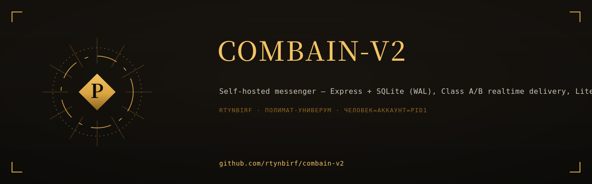

# COMBAIN v2 — self-hosted messenger

<div align="center">
  
</div>

<!--ФОРЖ:МУЗА:НАЧАЛО-->
<div align="center">
  
  <br/>
  
</div>
<!--ФОРЖ:МУЗА:КОНЕЦ-->


[](https://scorecard.dev/viewer/?uri=github.com/rtynbirf/combain-v2)
[](LICENSE)

Собственный мессенджер: **Express + better-sqlite3 (WAL)**, WebSocket-реалтайм,
замороженный SPA-фронтенд. Один контейнер, один файл БД, непрерывные бэкапы —
поднимается на любом VPS за 3 команды.

## Почему это не «ещё один чат-туториал»

| Подсистема | Что сделано |
| --- | --- |
| **Доставка (Class A/B)** | Сообщения, реакции и прочтения доставляются **всем онлайн-участникам** комнаты (фоновые бейджи работают), typing/presence — только подписчикам. |
| **Идемпотентность** | `(roomId, clientMessageId)` закреплён частичным уникальным индексом SQLite — ретраи и двойные отправки не создают дублей на уровне БД. |
| **Непрочитанные** | `GET /rooms` считает unread одним групповым запросом (не N+1), `MessageRead` — прочтения на каждое сообщение. |
| **Курсорная пагинация** | Opaque cursor `createdAt|id` со строгой валидацией — мусорный курсор = `400 INVALID_CURSOR`, а не пустая страница. |
| **Безопасность** | helmet, глобальный rate-limit (draft-7), анти-брутфорс на `/auth/login` + `/auth/register` (429 на неудачных попытках), fail-fast на дефолтный `JWT_SECRET`, WS-токен при апгрейде (close 4401), проверка `alg:none` подделок, CSWSH-фильтр Origin (`ALLOWED_ORIGINS`), лимит фрейма 128 КБ (close 1009), анти-флуд WS (close 4408). |
| **Наблюдаемость** | winston: JSON в проде / pretty в dev, ротация файлов 14 дней, access-логи (метод/путь/статус/мс/userId), WS-события, graceful shutdown (SIGTERM). `/api/health` + `/api/ready`. |
| **Эксплуатация** | HEALTHCHECK в образе, non-root, read-only FS, `cap_drop ALL`, tini, keep-alive таймауты за прокси. |
| **Бэкапы** | Litestream непрерывно реплицирует WAL в S3 — point-in-time restore без остановки сервиса. |
| **TLS** | Caddy с автоматическим Let's Encrypt, WebSocket из коробки. |
| **CI/CD** | Тесты на Node 22/24, CodeQL (`security-extended`), авто-публикация образа в GHCR (Node 22 LTS), Dependabot (npm+docker+actions). Все actions закреплены за **commit-SHA** (защита от атаки через теги), `GITHUB_TOKEN` — read-only по умолчанию. |
| **Supply chain** | SLSA build provenance каждого образа (публичный transparency log), OpenSSF Scorecard, SHA-pinned Actions, Dependabot (npm+docker+actions). |
| **Качество** | 63 интеграционных теста (REST + WS + security + изолированная БД + проверка индексов) — в CI на каждый PR. |

## Структура

```
public/                 замороженный фронтенд (10 модулей, без сборки)
backend/
  src/index.js          сервер, WS-апгрейд, health, helmet, rate-limit
  src/db.js             runtime-DDL + миграции (единственный источник схемы)
  src/services/store.js слой данных: комнаты, сообщения, реакции, курсоры
  src/ws/{hub,handlers} hub соединений (Class A/B) и обработчики событий
  src/utils/logger.js   winston: JSON/pretty, ротация 14 дней, access-логи
  src/routes/           auth, rooms, messages, users, groups
  test/smoke.js         63 интеграционных теста (REST+WS+security, изолированная БД)
  prisma/               документационная схема; runtime — src/db.js
deploy/                 Caddyfile, litestream.yml
docs/BACKEND_SPEC.md    полная спецификация (32 консолидированных правки)
```

## Быстрый старт

### Прод (Docker)

```bash
cp backend/.env.example .env
echo "JWT_SECRET=$(openssl rand -hex 32)" >> .env
docker compose up -d --build          # приложение на http://localhost:3000
```

Публично с HTTPS:

```bash
echo "COMBAIN_DOMAIN=chat.example.com" >> .env
docker compose --profile tls up -d    # Caddy сам получит сертификат
```

Бэкапы в S3 (Any S3-совместимое: AWS/R2/Backblaze):

```bash
cat >> .env <<'EOF'
LITESTREAM_S3_BUCKET=my-bucket
LITESTREAM_S3_REGION=us-east-1
LITESTREAM_ACCESS_KEY_ID=...
LITESTREAM_SECRET_ACCESS_KEY=...
EOF
docker compose --profile backup up -d
```

Готовый образ: `ghcr.io/rtynbirf/combain-v2:latest` — можно без `--build`.

### Разработка

```bash
cd backend
npm install
npm start            # http://localhost:3000, сид-юзеры test/test123, alice/alice123
npm test             # 63 теста, изолированная БД, случайный порт
```

## Переменные окружения

| Переменная | По умолчанию | Описание |
| --- | --- | --- |
| `PORT` / `HOST` | `3000` / `0.0.0.0` | Слушатель |
| `JWT_SECRET` | — | **Обязателен в проде** (fail-fast), `openssl rand -hex 32` |
| `JWT_TTL_SECONDS` | `604800` | Время жизни токена (7 дней) |
| `DATA_DIR` | `./data` | Каталог SQLite (WAL) |
| `UPLOAD_DIR` | `./uploads` | Каталог файлов |
| `MAX_FILE_SIZE` | `52428800` | Лимит файла, байт |
| `RATE_LIMIT_MAX` | `600` | Запросов/мин с одного IP |
| `AUTH_LIMIT_MAX` | `30` | Неудачных логинов/мин с IP (успешные не считаются) |
| `ALLOWED_ORIGINS` | пусто | CSWSH-фильтр WS: разрешённые Origin через запятую |
| `WS_MSG_LIMIT` | `60` | WS-сообщений на соединение за 10 с |
| `WS_MAX_PAYLOAD` | `131072` | Максимум байт на WS-фрейм |
| `LOG_LEVEL` | `http` | winston-уровень: error/warn/info/http/debug |
| `TRUST_PROXY` | `false` | `true` за Caddy/Nginx |
| `PUBLIC_DIR` | `../public` | Статика фронтенда |
| `ICE_SERVERS_JSON` | Google STUN | WebRTC-серверы |

## Health / мониторинг

- `GET /api/health` — живость процесса (для Docker/LoadBalancer).
- `GET /api/ready` — живость БД (`503`, если SQLite недоступен).

## Эволюция проекта

- **Phase 1 ✅** — unread-счётчики, Class A WS-доставка, 405 для direct-комнат, unique-индекс идемпотентности, security-хардненинг, CI/CD, Docker/Litestream/Caddy.
- **Phase 1.5 ✅** — анти-брутфорс аутентификации, CSWSH + WS-анти-флуд, winston-логи с ротацией, graceful shutdown, SHA-pinning CI, keep-alive за прокси.
- **Phase 2** — `User.deletedAt` (soft-delete/GDPR), `Room.pairKey` (быстрый поиск direct-пар), `RoomInvite`, `jti` + revocation для JWT, усиление валидации username/password, лимит 500 на `messageIds`, `forwardFromMessageId`.
- **Phase 3** — CSP для фронтенда, метрики Prometheus, E2E-шифрование.

Спецификация: [`docs/BACKEND_SPEC.md`](docs/BACKEND_SPEC.md) ·
Политика безопасности: [`SECURITY.md`](SECURITY.md)

<!--ФОРЖ:ПОДВАЛ-->
---

<div align="center">
  <sub>◆ картина и штандарт — ручная ковка <a href="https://github.com/rtynbirf">КУЗНИ ПОЛИМАТ</a> · ЧЕЛОВЕК=АККАУНТ=PID1 ◆</sub>
</div>
